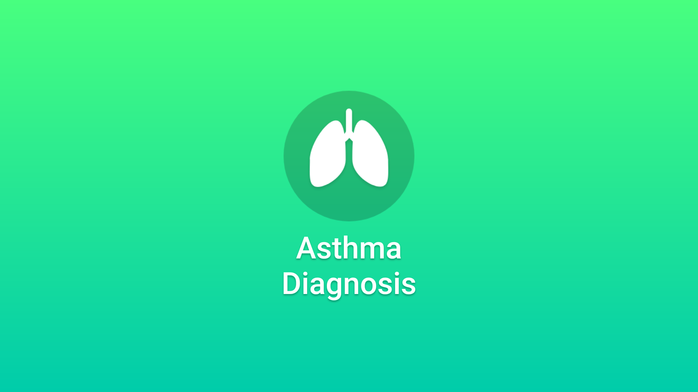

# Asthma Diagnosis

> A handy physician manual for diagnosing asthma using the GINA guidelines.

[](https://reactnative.dev/) [](#) [](#) [](#)

The application provides an efficient way of managing the patient details for easy access to the physicians. It enables the proper usage of the [GINA guidelines](https://ginasthma.org/2025-gina-severe-asthma-guide/) for diagnosing a patient for asthma as well as for determining the severity of a patient’s asthma.



## Features

Here's a list of things that can be done with Asthma Diagnosis:

- Physician authentication
- New patient registration
- Follow-up patient checkup
- GINA guidelines based recommendation system

### Physician authentication

Only authorized and validated physicians are allowed to use the application features. This application uses simple **validated email + password** based auth.

### New patient registration

New patient history, background and symptoms are recorded during a physical consultation with the physician. These details are requested in the format and granularity specified in the GINA guidelines.

### Follow-up patient checkup

When a patient visits for a follow-up, the physician is able to access all the required details via the application. Based on the GINA guidelines and the patient's details, the physician is able to access everything in one place.

### GINA guidelines based recommendation system

Based on the symptoms recorded for the patient, the application uses the GINA guidelines to provide the physician with a recommendation regarding the severity of patient's asthma.

## Getting started

Before getting started, make sure to setup the react native dev environment based on your OS. Head on to [reactnative.dev](https://reactnative.dev/docs/set-up-your-environment) for the detailed instructions.

1. Setup the backend base url under `app/config/API.js`
2. Clone the repo
   ```sh
   git clone https://github.com/vinayakmalviya/AsthmaDiagnosis.git
   cd AsthmaDiagnosis
   ```
3. Install npm packages
   ```sh
   npm install # or use pnpm or bun
   ```
4. Start the metro server
   ```sh
   npm start
   ```
5. Build and install on your target platform (iOS or Android)
   ```sh
   npm run ios # or android
   ```

## Contributing

Contributions are what make the open source community such an amazing place to learn, inspire, and create. Any contributions you make are **greatly appreciated**.

If you have a suggestion that would make this project better, please fork the repo and create a pull request. You can also simply open an issue with the tag "enhancement".
Don't forget to give the project a star! Thanks again!

1. Fork the Project
2. Create your Feature Branch (`git checkout -b feature/amazing-feature`)
3. Commit your Changes (`git commit -m 'Add something awesome'`)
4. Push to the Branch (`git push origin feature/amazing-feature`)
5. Open a Pull Request

## License

Distributed under the MIT license. See `LICENSE` for more information.
